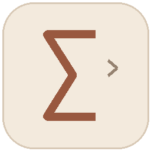

# MathCode · 数学 × 编程

Offline learning workspace for mathematics and C++.

把读题、知识点回顾、C++ 编码与练习复盘放在一个离线桌面工作区。

**技术栈 / Stack:** Python · SQLite · WPF · WebView2 · JavaScript



## 能做什么

- 按主题组织课程与题目，阅读时保留当前题目和草稿。
- 目录恢复筛选、页码、滚动和焦点，减少学习过程中的来回寻找。
- 个人练习记录、代码目录管理与版本快照，SQLite 本地持久化。

## 安装与运行

Python 3.11+；原生桌面壳另需 Windows、.NET 8 SDK 与 WebView2 Runtime。

```powershell
python scripts/create_demo.py
python start.py serve
```

浏览器打开 http://127.0.0.1:8778/ 。桌面版构建：

```powershell
powershell -NoProfile -File scripts/configure.ps1
powershell -NoProfile -File scripts/build.ps1
```

`requirements-import.txt` 仅供可选资料导入功能使用。公开版内置的演示内容由发布脚本原创生成；个人题库、学校课件、答案扫描及学习记录未公开。导入自己的合法资料需按 `study/importer.py` 的清单结构准备。

## 验证

```powershell
python -m unittest discover -s scripts -p "test_*.py"
dotnet build desktop/MathCode.Desktop/MathCode.Desktop.csproj -c Release
```

命令结果与验收范围见 [VALIDATION.md](VALIDATION.md)。这些检查不能替代目标机器上的原生桌面验收。

## 发布范围

[公开源码说明](PUBLICATION.md) · [全部作品](https://github.com/YUANYZ-cell)
